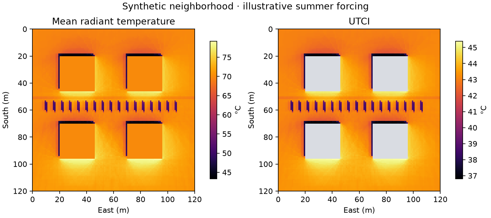

# Example walkthrough

Run a complete simulation on a generated neighborhood and weather series:

```bash
python examples/synthetic_scene.py --output /tmp/utherm-example
```

This creates a small scene with buildings and trees, runs a synthetic summer
day, and writes `UTCI_0_0.tif` and `TMRT_0_0.tif` under
`/tmp/utherm-example/output_folder/0_0/`. The forcing is illustrative and must
not be interpreted as an observed weather record. CPU execution may take several
minutes. The command refuses an existing output directory to avoid mixing runs.



Illustrative outputs at 13:00. Gray UTCI cells are masked buildings. Generate
this view with `python tools/plot_example.py /tmp/utherm-example --output example.png`.

The generated inputs are illustrative; use the [input reference](../docs/INPUTS.md)
when preparing a real neighborhood.
